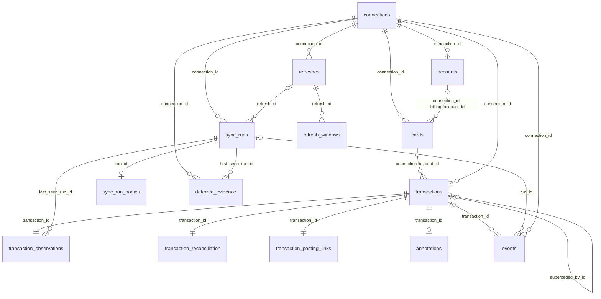

# Database reference

The database holds declared financial evidence, current transactions, independent
owner annotations, the durable event feed and operational state. This page owns
table ownership, relationships, commit boundaries, the reasons for dialect
differences, migration compatibility, the installation binding and backup and
recovery. The [API reference](api.md) owns what clients see.

## Ownership and physical layout

| Area                 | Tables                                                                                                                                            | Owner                                                  |
| -------------------- | ------------------------------------------------------------------------------------------------------------------------------------------------- | ------------------------------------------------------ |
| Financial data       | `connections`, `accounts`, `cards`, `sync_runs`, `transactions`, `annotations`, `events`                                                          | Application migrations and shared financial store      |
| Evidence and state   | `sync_run_bodies`, `sync_run_history`, `deferred_evidence`, `transaction_observations`, `transaction_reconciliation`, `transaction_posting_links` | Application migrations and shared financial store      |
| Events delivery      | `event_subscriptions` (SQLite/libSQL), `operations.event_subscriptions` (PostgreSQL)                                                              | Application Events store                               |
| Scheduled collection | `scheduled_collections`, `settings`                                                                                                               | Scheduled collection contract in every store           |
| Provider credentials | `provider_credentials` (SQLite/libSQL), `operations.provider_credentials` (PostgreSQL)                                                            | Credential vault; encrypted rows only                  |
| Installation binding | `settings` row `installation` (SQLite), `operations.installation` (PostgreSQL)                                                                    | [State directory binding](#state-directory-and-backup) |
| Refreshes            | `refreshes`, `refresh_windows`                                                                                                                    | Refresh service; lease-fenced while running            |
| Collection leases    | `collection_leases`                                                                                                                               | Collection lock on every backend                       |
| Hosted Google bridge | `identity.fonds_neon_login`, `identity.fonds_neon_identity`                                                                                       | Application authentication bridge                      |
| Hosted identity      | 14 Better Auth tables listed in the [identity inventory](internals/auth-storage.md)                                                               | Pinned Better Auth 1.7.10 and configured plugins       |
| Migration version    | `PRAGMA user_version` (SQLite/libSQL), `schema_migrations` (PostgreSQL)                                                                           | [Migrations](#migrations)                              |
| D1 concurrency       | Additional `connections.revision` column                                                                                                          | Experimental D1 migration and adapter                  |

PostgreSQL puts the financial tables in `financial`, which every pool selects
through `search_path`, and operational state in `operations`; a Fonds database
holds one installation. Authentication uses a separate `identity` pool, while the
Events and credential stores qualify their `operations` tables explicitly, without
foreign keys into a schema each deployment's `search_path` names. SQLite and
libSQL keep the operational tables beside the ledger. Financial records have no
owner-user foreign key, because the service has one owner, and there is no
implicit join between a financial connection ID and a Better Auth account ID.

Columns, types, checks and indexes are in the SQL files, the source of truth:
[SQLite/libSQL](../migrations/), [PostgreSQL](../migrations/postgres/) and
[D1](../migrations/d1/). [Drizzle declarations](../src/storage/sqlite/schema.ts)
and their [PostgreSQL counterpart](../src/storage/postgres/schema.ts) map domain
properties to columns. JSON document shapes are the schemas that validate them:
the [domain model](../src/domain/model.ts), [records](../src/domain/records.ts),
[run validation](../src/domain/plans/sync.ts) and the
[subscription schema](../src/application/events.ts). Embedded SQL and declaration
manifests are generated and checked; the
[maintenance guide](internals/repository-layout.md#sql-embedded-migrations-and-schema-manifests)
explains regeneration.

## Relationships



Foreign keys cascade where migrations specify. Accounts, cards and transactions each carry `UNIQUE (connection_id, id)`,
so a composite foreign key can only reference a row of the same connection. An
event always has a connection and may have no transaction or run (an owner action
has no source run). A card's `billing_account_id` is the account that pays its
bills; no foreign key asserts another account relationship. The planner, not SQL,
ensures a `purchase_id` names a purchase row of the same collection scope.
Candidate IDs and source references inside JSON are references, not foreign keys.

## What the financial tables hold

- **`connections`** hold provider, label and open, versioned configuration with
  internal cursors. Unknown configuration keys survive.
- **`accounts` and `cards`** are unique by connection and private provider key.
  Card attributes are private, allowlisted facts.
- **`sync_runs`** hold receipts: scope, times, versions, coverage, warnings, input
  digest and applied marker.
  **`sync_run_bodies`** holds recovery staging and expiring opt-in debug bodies.
  Later ingestion prunes expired debug bodies; unfinished recovery is preserved.
  **`sync_run_history`** caches each connection's fold of applied runs, rebuilt
  from `sync_runs` when stale.
- **`transactions`** hold current transactions, private identity, lifecycle and
  canonical money/basis. Source identity is not unique. Mapped scalars have named
  columns; explanatory text, FX steps and source issues have typed JSON columns.
  `provider_json` holds allowlisted source evidence; `source_absence_json` holds
  the latest proving run and capture time, independently of observation state.
  Null legacy values remain unknown: migration never derives absence from
  `not_returned`. `details_json` and schedules are absent.
- **`transaction_observations`** owns latest scoped freshness/references; unchanged
  refreshes preserve content. **`transaction_reconciliation`** owns identity,
  interpretation, conflict, rejection and private pending/posted overlap.
  `source_evidence_json` separates captured identity and accepted financial receipts.
  Unprovable legacy groups remain deferred indefinitely, including new charges,
  making totals incomplete. Retries cannot repair provenance. IDs, money and
  annotations survive; owner removal/recollection creates distinct identities
  without annotation transfer.
  **`transaction_posting_links`** holds reversible current pending components,
  overlap evidence and split receipts, separate from mapped facts and immutable
  events.
- **`deferred_evidence`** holds declared evidence without safe transaction identity.
  Content-addressed rows retain first and last receipts, deduplicating evidence.
- **`annotations`** have at most one row per transaction; absence has no row and
  version zero. Earlier documents live in `annotation.updated` events, not version
  tables.
- **`events`** are append-only financial, annotation, review and health events
  for audit and catch-up, not complete event sourcing. Their type-specific
  before/after documents retain changed values. Public events expose metadata,
  baseline summaries and `changedFields`, never private evidence. Event history
  remains independently of debug-body expiry.

Perspectives are filters over `transactions`, not views or tables, and totals are
exact SQL integer sums with no stored total column
([perspectives](api.md#perspectives)).

## Dialect differences and their reasons

- PostgreSQL financial text is `TEXT COLLATE "C"`, so ordering is bytewise like
  the shared identity rules, in a UTF8 database with explicit null ordering.
  Integers are `BIGINT` with safe JavaScript integer bounds; SQLite tables are
  `STRICT`.
- Transaction calendar dates are PostgreSQL `date`, checked to years 0001–9999,
  and `YYYY-MM-DD` text on SQLite. In that range PostgreSQL's ISO output is the
  stored text, so dates round-trip exactly and sort, filter and page as SQLite
  text does. PostgreSQL has no year zero, so the domain rejects it everywhere.
  Financial pools set `DateStyle` to ISO; initialization refuses another style,
  and a read under one fails rather than reinterpret a date.
- IDs stay text: the API matches any ID string exactly, and not every ID is a
  UUID. A `uuid` column would error on other strings and equate UUID spellings
  that SQLite keeps distinct.
- Financial timestamps stay text: the application compares them as ISO strings,
  while `timestamptz` returns another text form and microsecond precision.
  Changing them needs one canonical form and precision on every backend first.
- JSON documents are text, not JSONB, so exact source strings survive: actual NUL
  and a literal backslash-u0000 stay distinct. JSON documents and annotations may
  hold NUL, but canonical scalar text rejects it on every adapter: extraction
  keeps declared evidence, flags the row and marks its partition non-comparable
  while valid rows still apply. SQLite checks JSON syntax; PostgreSQL relies on
  domain validation.
- Body-free receipts avoid historical body loads and PostgreSQL JSON decoding of
  embedded NUL. Merchant contact/location scalars use reversible escaping when
  needed, preserving NUL and literal escapes across drivers.
- PostgreSQL sequences give captures and transactions deterministic order where
  SQLite uses rowid.
- Application code supplies IDs, versions, timestamps and empty documents. SQL
  checks shapes; currency precision and SQLite's canonical dates are domain
  validation.
  Direct SQL writes are not a supported import path.
- D1 has no interactive transaction: `connections.revision` guards one atomic
  batch, and a stale batch fails ([D1 note](internals/d1-storage.md)).

## Commit boundaries

Receipts and staged bodies commit together before reconciliation. Failed
application leaves recoverable evidence with `applied_at` unset. Ledger changes,
observations, deferred evidence, events, the applied marker and body release commit
atomically (one guarded D1 batch). A purchase precedes its billed lines; retargeted
lines move with the survivor and their version/update events. Annotation edits
commit owner state and history together. Card discovery commits under the connection
lock before further financial requests, keeps known metadata when new values are
missing or conflicting, and creates no financial event or revision.

PostgreSQL locks the connection row before reading mutable state and holds a
transaction-scoped advisory lock before allocating event IDs, with sequences at
`CACHE 1`, so a later committed cursor cannot skip an earlier uncommitted ID.
Rollback gaps in event IDs are valid. Internal consumer cursors are acknowledged
with an expected prior cursor under the adapter's write boundary, preserving
other consumers and settings; public consumers keep their own checkpoints.
Delivery runs outside financial transactions and is at least once. The feed is
connection-scoped, not a global concurrent-consumer cursor, and the guard against
overlapping delivery for one consumer is in-process, not a lease.

## Events delivery table

`event_subscriptions` has no foreign key to financial connections or identity
users and clients; authorization validates them. Its scalar columns project the
validated JSON state for due-delivery reads, and writes compare the previous
generation and update both together. The signing secret is private; no bearer
credential is stored. Because a webhook can succeed before its cursor persists,
a retry keeps a stable event identity. Grant rechecks are in the
[security model](security-model.md#revocation) and delivery in the
[API reference](api.md#mcp-and-events).

## Collection leases table

The collection lock is one `collection_leases` row per connection on every
backend, so a refresh holds no database session while it calls the provider and
can continue in another process. The
[lock interface](../src/application/collection-lock.ts) and
[lease](../src/storage/collection-lease.ts) own the protocol: expiry on the
database clock, so processes need not agree on time, and token-fenced writes.

## Refresh tables

`refreshes` records each [refresh](api.md#refreshes) and each scheduled occurrence
that did not run, without financial values. A start inserts it under the
connection's write lock, which also evaluates every admission rule; the database
admits one pending or running refresh per connection and one record per
occurrence, and every update while it runs is lease-fenced. `refresh_windows`
holds a backfill's month checkpoints, deleted with their refresh; a resumed
refresh redoes each unfinished window whole, because replaying identical evidence
is quiet. Deleting a refresh clears `sync_runs.refresh_id`; receipt and financial
history remain independently of debug-body expiry.

## Scheduled collections and settings tables

These operational tables hold no financial values and back the
[scheduled collection contract](../src/application/scheduled-collections.ts) on
every store, so [scheduling](guides/hosted-service.md#scheduling) works the same
on each. `scheduled_collections` records claimed occurrences by UTC minute, so
one occurrence runs once across restarts, replicas and the trigger endpoint; a
claim's lease and the pruning of old claims are constants in that contract.
`settings` keeps generated values: the installation's `collection_time`, inserted
once by the first start that needs it (an operator's `FONDS_REFRESH_TIME` wins
without changing it), and on SQLite the `installation`
[binding](#state-directory-and-backup).

## Provider credentials table

The `connect` command stores one connection's provider credentials as an
AES-256-GCM ciphertext. [The vault](../src/runtime/credential-vault.ts) encrypts
in the runtime with `FONDS_CREDENTIALS_KEY` from the
[state directory](#state-directory-and-backup), so the key never enters the
database and a copied database or backup exposes no provider password. The
additional data binds each ciphertext to its provider and connection, so a row
copied to another connection fails to decrypt, and every decryption failure has
one fixed message. Plaintext is validated against the provider's fields when
stored and when loaded. Credentials never pass through HTTP, MCP, logs or command
output.

## Authentication and bridge tables

The hosted `identity` namespace holds Better Auth's tables and the application's
Neon login and identity bridge. [Identity storage](internals/auth-storage.md) owns
their ownership, security and recovery; their schema derives from the pinned
Better Auth configuration, not the financial declarations. Do not copy, inspect or
modify live auth rows as part of financial API work.

## Migrations

This pre-release initializes from `0001` and numbered forward migrations for
[SQLite/libSQL](../migrations/) and [PostgreSQL](../migrations/postgres/), covering
`financial` and `operations`. Earlier pre-release layouts are unsupported: stop Fonds, explicitly recreate the database or volume, then
initialize it again. Current baseline databases upgrade in place; migrations stay
immutable and numbered without gaps.

SQLite initializes on opening, libSQL and PostgreSQL at provisioning. One
transaction under SQLite's write lock or a PostgreSQL advisory lock checks the
recorded version and live declarations against the generated manifest. A matching version is insufficient. Unsupported layouts are refused, never erased automatically; failed initialization rolls back. A matching
database runs no migration SQL or version write. Restore requires this compatible
schema and its matching installation secrets.

D1 applies [its copies](../migrations/d1/), the SQLite files plus the connection
revision, with Wrangler and checks neither version nor declarations. Better
Auth's migration API owns the `identity` tables
([auth storage](internals/auth-storage.md)). Backups are not interchangeable
between backends.

## State directory and backup

Every Node target keeps its secrets in one file, `fonds.env`, in a state
directory: `FONDS_STATE_DIR`, which PostgreSQL entry points require, or for SQLite
by default the data directory that holds the default database (`$FONDS_HOME`,
otherwise the per-user data directory). Experimental Turso has no state
directory or installation binding. On Neon, the private env file, which reaches
its processes as their environment (with Neon's `FONDS_NEON_GOOGLE_AUTH_URL`), is
its state, generated by `neon:setup`. The first start that needs it generates the
whole file once, under a lock, as a `0600` file renamed into place:
`FONDS_AUTH_SECRET`, `FONDS_OWNER_ID`, `FONDS_CREDENTIALS_KEY` (decrypts stored
provider credentials), `FONDS_SCHEDULE_SECRET` (an external scheduler's
bearer), `FONDS_REFRESH_SECRET` (the hosted operator refresh route's bearer) and
`FONDS_API_TOKEN` (a loopback server's bearer). Secrets come only from this file. An existing file is never
completed or regenerated: one without the owner ID, auth secret or credentials key
is refused, and an operator may remove the optional entries. The directory must be
an owned `0700` directory and the file an owned `0600` regular file without links;
Fonds never changes their permissions. Ledgers that share a state directory share
its secrets.

**Binding.** A database is bound to the installation that initialized it: the
SHA-256 digest of its auth secret, its owner ID and its credentials key ID,
recorded once, in the same step that initializes a new SQLite file (the
`installation` [setting](#scheduled-collections-and-settings-tables)) and, on
PostgreSQL, in the [migration](#migrations) transaction that creates its
`financial` namespace and tables (`operations.installation`, written by the
`init`, loopback start, hosted start or `neon:setup` that provisions it; an
existing schema is never bound afterwards, even without rows). Every command,
server and login link compares the whole fingerprint exactly and refuses the
database if it differs or if an existing database has none, so a lost or
replaced state directory never silently re-keys a database. Comparing writes
nothing. On Neon the private env file is the state: the Function and setup's
login link compare its fingerprint.

**Backup.** A backup is the database and its state directory together; neither
restores without the other. Refreshing again can recover accessible source facts, but
not former observations, owner annotations or periods a provider no longer
serves. Keep both copies as private as the originals. A coherent backup holds
snapshots, transactions, annotations, events and consumer cursors; never copy only
a live WAL file. Local backup and restore is tested; hosted recovery is a
[manual release gate](internals/acceptance.md#manual-release-gates), and restored
history must be coordinated with external recipients before delivery resumes.

- **SQLite:** `backup --out <path>` writes a coherent copy of the ledger as a new
  `0600` file (it never overwrites one) and prints the state directory it
  belongs to; copy its `fonds.env` with it.
- **PostgreSQL:** `pg_dump` the database and copy `fonds.env` (`/data/fonds.env`
  in the [compose stack](guides/docker.md#backup-restore-and-upgrades)).

To restore a SQLite ledger, with `DB` the ledger path (`--db`, or `fonds.sqlite`
in the data directory) and `STATE` its state directory:

1. Stop every Fonds process using the ledger: HTTP and stdio servers (including
   those an MCP client starts), and any `refresh` or `consume` run.
2. Move the current ledger aside together with its `$DB-wal`, `$DB-shm` and
   `$DB-journal` files. A WAL file left beside a restored ledger is not its own.
3. Copy the backup to the ledger path as a private file:
   `install -m 600 /private/backups/fonds.sqlite "$DB"`. The directory must stay
   `0700` and owned by the user running Fonds.
4. Restore the state file from the same backup set into an owned `0700`
   directory: `install -m 600 /private/backups/fonds.env "$STATE/fonds.env"`.
5. Verify before starting servers or refreshes again. Opening the ledger checks
   its schema and binding; the expected connections, and their transactions and
   events, must read back:

   ```sh
   fonds list-connections --db "$DB"
   fonds list-transactions --db "$DB" --limit 5
   fonds list-events --db "$DB" --connection-id cal-main --limit 5
   ```

   Consumer cursors are as of the backup, so `consume` delivers any later events
   again.
