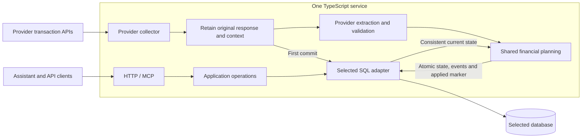

# Service design

Fonds collects financial evidence, reconciles current transactions and preserves
independent owner annotations: one TypeScript service with HTTP, MCP and CLI
interfaces, whose provider adapters share one core. The first release is a small
personal evidence register with exact money, conservative identity, reversible
lifecycle decisions and durable consumer catch-up. Budgeting UI, general
accounting, broad connector frameworks and automatic financial interpretation by
an LLM are out of scope. This page owns the shared invariants; the
[API reference](api.md) owns record meanings, the [database reference](database.md)
persistence and recovery, the [repository layout](internals/repository-layout.md)
modules and wiring, and [reference models](reference-models.md) the reasons for
the contract's shape.

## How the service fits together

Collectors own provider authentication, discovery, request windows and
demonstrated paging. Extraction turns one archived response into validated
provider-neutral input. Shared planners decide identity, financial changes,
annotations and lifecycle transitions without driver dependencies, and storage
adapters ([backends](guides/storage-backends.md)) execute the finite plans
atomically. Financial state belongs in the application database: assistant memory
and webhook payloads are not a ledger, and authentication and subscription
delivery keep their own storage without a second financial model.

## Collection and evidence

Each capture and its safe collection context commits before extraction and before
the next provider request; a provider that assembles one capture from several
responses says in its guide what an interrupted unit loses. Financial application
is a separate transaction that commits transactions, events and the run's applied
marker together, so a failure leaves the evidence for retry. Provider calls never
run inside financial write transactions.

The archive keeps exact response text, numeric tokens, unknown keys and null/empty
distinctions, with endpoint, scope, capture time, versions and coverage.
Validation can reject an oversized or unsupported row without discarding or
truncating its response. Run IDs identify immutable evidence: different evidence
under one ID fails, replaying an applied run is quiet, and an unapplied archive
needs its parser version. A policy version in recent-capture fingerprints makes a
policy change defeat identical-content skipping once; there is no historical
reinterpretation.

- **Backfill** requests a bounded historical range (about seven years is enough).
  Providers own windowing, paging, overlap and budgets; partial results are kept
  and inaccessible periods are reported as gaps.
- **Incremental refresh** rereads the provider's overlapping recent window, never
  narrowed by a last-seen transaction or delivery cursor. Unchanged records stay
  quiet, and corrections preserve annotations.

Successful responses do not certify completeness. Resources, cards, filters and
posted or pending partitions scope comparability and health recovery: a filtered
success cannot clear an unrelated failure, child windows do not resolve an
interrupted broad range, and unknown continuation metadata makes a capture
incomplete. Collection is API-only, without browser automation or statement
fallback; authentication challenges and rate limits stop it, and bodies, timeouts,
retries and failure budgets are bounded. An identical recent capture is skipped
only when fingerprint, versions, scope and an unchanged ledger revision prove it
equivalent; the skip archives nothing and leaves `lastSeenAt` alone. Endpoints,
budgets, roles and archiving exceptions belong to the provider guides
([CAL](providers/cal.md), [Isracard](providers/isracard.md)).

## Personal data

The service keeps what it needs to reconcile transactions and nothing that merely
identifies the owner. Login, initialization and card-list responses carry names,
email, phone and national ID numbers, which the service never needs: collection
uses server-side credentials, the owner is identified by OAuth and cards by
provider keys. Storing them would raise the cost of every leaked database, backup
or copy for no benefit. Exact retention therefore has these exceptions:

- Login bodies, credentials, tokens and authentication headers are never stored.
- Responses that carry personal data and are not financial evidence (the CAL
  initialization response, the Isracard card list) keep an adapter-applied
  allowlist of fields. Redacting a stored copy would break exact archives; an
  allowlist keeps both rules, and card state is reread at every login, so no
  history is lost. A new field is kept only once allowlisted.
- Financial responses stay exact even when they embed holder data, which is never
  parsed into public fields unless a provider guide says so. The one change is a
  credential echo: Isracard replaces the login identity number in known holder
  fields with a fixed marker before archiving.
- A provider may refuse a response, such as an application error or one that
  echoes credentials outside known fields, and discard its body; its guide says
  when.

Bank account numbers become private provider keys and are never exposed. Each
provider guide lists its allowlist and refusals:
[CAL](providers/cal.md#personal-data),
[Isracard](providers/isracard.md#personal-data).

## Accounts and cards

Cards and **billing accounts** (the bank account that pays a card bill) are
connection-scoped resources with service IDs; provider keys stay private and
anchor identity. Accounts come only from discovery, a card referenced before
discovery exists with null metadata, absence never closes either, and equal last
digits, names or masks never merge distinct keys. The private collection scope
partitions source identity and absence comparison and is never public.

## Identity, corrections and absence

Native-key collisions and legitimate duplicate-looking purchases keep their
multiplicity. Changed multiplicity or ambiguous candidates stay reviewable and
never inherit annotations by row order. Older evidence never overwrites newer
facts. A [versioned field](api.md#versioned-fields) change advances the version
and emits `transaction.updated`; enrichment refreshes quietly.

`not_returned` means a comparable successful response omitted a known identity,
not that it was cancelled or removed; failed partitions cannot unlist rows, and
unlisted posted spending stays in totals. Explicit removal keeps record,
annotations and evidence while excluding the row from spending, and only a fresh
reappearance undoes it. An adapter may set a recent absence horizon and reject an
implausibly empty recent posted capture while eligible posted rows remain; the
rejection is a failed, applied `implausible_empty` run that writes nothing else
and cannot be replayed into the ledger. Provider guides say which adapters do.

## Purchases and billed lines

An installment plan is one **purchase** row carrying the whole commitment plus one
**billed line** per payment, all ordinary transaction rows with their own
versions, events, presence and annotations. One purchase exists per plan, created
from any observed row. Conflicts are flagged and leave values unknown rather than
split a plan. A total is never computed by multiplying a payment, no schedule is
generated, and fewer observed lines never mean an incomplete plan. Billed lines are
never compared for absence or matched. A purchase restated as a non-plan keeps
the plan's facts, so a purchase and its lines are never both counted. A provider
that cannot prove a plan emits one row per source item with null installment
fields. The [API](api.md#purchases-and-billed-lines) owns the fields, issue codes
and [perspectives](api.md#perspectives); perspective membership depends only on a
row's own facts, so selection and paging stay in SQL without database views.

## Pending-to-posted matching

Automatic matching is a narrow, reversible, opt-in provider capability. A
disappearing pending authorization keeps its service ID when a new posted identity
with the same purchase date, card and signed purchase money arrives in a fresh
capture with comparable pending coverage and successful posted extraction. Shared
code groups every plausible candidate before testing eligibility; every member
must pair, and the adapter may reject the whole group using its source evidence.
An adapter cannot widen the shared safeguards. Where its policy permits twins,
indistinguishable rows pair in a fixed arbitrary order. No conversion or guessed
rate is used. The posted row is retained
with `supersededById`, and one revision commits `transaction.posted` and
`transaction.linked` with decision evidence, but no `transaction.created` or
`transaction.unlisted` for the pair. Billed lines of a retired purchase move to the
survivor in the same write (an unlink moves them back) and are never matched
themselves. Because this is a heuristic, a false link is possible, so explicit
split is part of the design; similarity alone yields review candidates.

Owner decisions carry the current transaction and annotation versions and a
reason ([API](api.md#pending-to-posted-matching)):

- **Link** keeps the pending ID. Conflicting nonempty annotations block it; equal
  ones survive, or the posted one moves to an empty survivor. Automatic links leave
  annotations unchanged, so dependent approvals can become stale.
- **Unlink** restores both rows on their own IDs with their annotations, and the
  pair is never suggested or matched automatically again. Unchanged retries are
  quiet.
- **Confirm removal** keeps evidence and annotations; unknown-window absence never
  invokes it, and a reappearance must postdate both evidence and decision.

Providers opt in through [source-adapter.ts](../src/domain/source-adapter.ts), and
each guide says whether it does. Provider code owns keys, mappings,
comparability, horizons and source compatibility; shared code owns grouping,
freshness, eligibility, lifecycle and annotation ownership and never branches on
provider name. The rules live in
[auto-posting.ts](../src/domain/plans/auto-posting.ts) and its tests.

## Annotations, reads and delivery

Annotations are independently versioned owner documents that source refresh never
writes. A review change also guards the transaction version, and staleness
compares recorded money, currency, basis and kind, not versions. Reads are live
and bounded; only `get_refresh` collects, to [resume](api.md#refreshes) an
interrupted refresh. Writes return committed receipts; with no
general command idempotency, an uncertain outcome needs a reread. The event feed
names records to refetch, not deltas, and imports are not fresh spending.
Consumers store `nextCursor` after processing; `changes.available` webhooks only
wake them, so polling recovers a missed wake-up. Callbacks run outside SQL
transactions and can repeat after a failed acknowledgement, so receivers
deduplicate on the stable delivery key; exactly-once delivery is not promised.

## Runtime and deliberate limits

Collection runs in the service, independently of reads, the same on every
supported backend, as recorded [refreshes](api.md#refreshes) under one
per-connection [lock](../src/application/collection-lock.ts). Scheduled collection
is off until [configured](guides/hosted-service.md#scheduling). Composition is
static, not plugin discovery. Owner identity and exact resource and operation
scopes constrain access ([admission](security-model.md#admission)); local bearer HTTP
and stdio are single-client interfaces. Schema changes ship as
[migrations](database.md#migrations), and recovery pairs a database with its
[state directory](database.md#state-directory-and-backup).

The seven financial tables are not an architectural constraint. Beyond the
collection lease, distributed coordination, commit chains, chunk protocols,
general merge and replay frameworks, historical reinterpretation, bidirectional
sync and broad exporters wait for a concrete requirement.
[Acceptance](internals/acceptance.md) indexes the behavioral checks.
