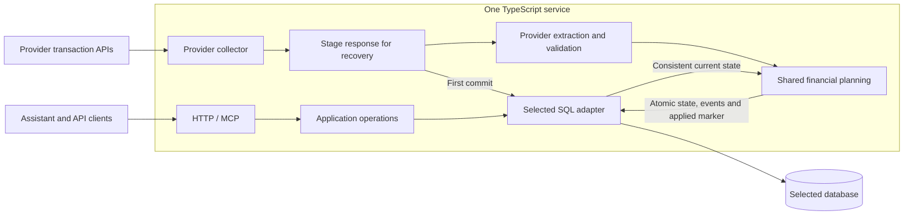

# Service design

Fonds collects financial evidence, reconciles current transactions and preserves
independent owner annotations: one TypeScript service with HTTP, MCP and CLI
interfaces, whose provider adapters share one core. The first release is a small
personal evidence register with exact money, conservative identity, reversible
lifecycle decisions and durable consumer catch-up. Budgeting UI, general
accounting, broad connector frameworks and automatic financial interpretation by
an LLM are out of scope. This page owns the shared invariants; the
[API reference](api.md) owns record meanings, the [database reference](database.md)
persistence and recovery, the [repository layout](internals/repository-layout.md)
modules and wiring, and [reference models](reference-models.md) the reasons for
the contract's shape.

## How the service fits together

Collectors own provider authentication, discovery, request windows and
demonstrated paging. Extraction turns one staged response into validated
provider-neutral input. Shared planners decide identity, financial changes,
annotations and lifecycle transitions without driver dependencies, and storage
adapters ([backends](guides/storage-backends.md)) execute the finite plans
atomically. Financial state belongs in the application database: assistant memory
and webhook payloads are not a ledger, and authentication and subscription
delivery keep their own storage without a second financial model.

## Collection and evidence

Each refresh month or recent window commits its captures and safe collection
context together before extraction, even when interrupted or stopped;
[resuming](api.md#refreshes) refetches what a crash loses. Provider guides state
what interrupting a multi-response capture loses. Financial application
is a separate transaction that commits transactions, events and the run's applied
marker together, so a failure leaves the evidence for retry. Provider calls never
run inside financial write transactions.

Normal operation retains declared transaction evidence and capture receipts.
Raw bodies are staged for recovery, then released with application unless bounded
debugging retention was requested. Legacy archives remain. Unknown fields are
discarded; recollection cannot recover vanished values or expired periods.
Declared evidence without a safe transaction identity is retained separately.

Input digests preserve run-ID immutability after body removal; applied replay is
quiet. Recovery needs the staged body and matching parser. Historical
reinterpretation is unsupported. Retained row evidence could support re-deriving
individual rows, but not identity grouping or pending-to-posted linking, which
need whole responses. Retained coverage receipts support source membership
without recovering raw bodies.

- **Backfill** requests a bounded historical range (about seven years is enough).
  Providers own windowing, paging, overlap and budgets; partial results are kept
  and inaccessible periods reported as gaps.
- **Incremental refresh** rereads the provider's overlapping recent window, never
  narrowed by a last-seen transaction or delivery cursor. Unchanged records stay
  quiet; corrections preserve annotations.

Successful responses do not certify completeness. Resources, cards, filters and
posted or pending partitions scope comparability and health recovery: a filtered
success cannot clear an unrelated failure, child windows do not resolve an
interrupted broad range, and unknown continuation metadata makes a capture
incomplete. Collection is API-only, without browser automation or statement
fallback; authentication challenges and rate limits stop it, and bodies, timeouts,
retries and failure budgets are bounded. Every capture reconciles against current
state and policy within its scope: rows near the month or window it requested,
pending authorizations, linked components and rows its observations name by
identity, purchase, link or candidate. Other rows keep their state until a capture
covers them; a scope found incomplete widens to every row. Unchanged content
advances receipt/observation freshness without
transaction-row writes or change events. Capture rules belong to the provider guides
([CAL](providers/cal.md), [Isracard](providers/isracard.md)).

## Personal data

The service keeps what it needs to reconcile transactions and nothing that merely
identifies the owner. Some provider responses carry names, contact details and
national ID numbers, which the service never needs: collection uses server-side
credentials, the owner is identified by OAuth and cards by provider keys. Storing
them would raise the cost of every leaked database, backup or copy for no benefit.
Exact retention therefore has these exceptions:

- Login bodies, credentials, tokens and authentication headers are never stored.
- A response that carries personal data and is not financial evidence keeps only
  an adapter-applied allowlist. Card state is reread at login; new fields need
  explicit inclusion.
- Staged and opt-in archived financial responses stay exact even when they embed
  holder data, which is never
  parsed into public fields unless a provider guide says so. The one change is a
  credential echo, which a provider may replace with a fixed marker in known
  holder fields before archiving.
- A provider may refuse a response, such as an application error or one that
  echoes credentials outside known fields, and discard its body.

Bank account numbers become private provider keys and are never exposed. Each
provider guide lists its allowlist, markers and refusals:
[CAL](providers/cal.md#personal-data),
[Isracard](providers/isracard.md#personal-data).

## Accounts and cards

Cards and **billing accounts** (the bank account that pays a card bill) are
connection-scoped resources with service IDs; provider keys stay private and
anchor identity. Accounts come only from discovery, a card referenced before
discovery exists with null metadata, absence never closes either, and equal last
digits, names or masks never merge distinct keys. The private collection scope
partitions source identity and absence comparison and is never public.

## Identity, corrections and absence

Native-key collisions and legitimate duplicate-looking purchases retain
multiplicity. Ambiguous candidates or changed multiplicity stay reviewable, never
inheriting annotations by row order. Older evidence cannot overwrite newer facts. One declaration governs
retention/versioning of mapped facts and private provider evidence; posting
retains lifecycle events. Observations remain separate; mapped facts/lists use
named columns. The [API](api.md#versioned-fields) owns notifications.
Source identity compares captured facts, never held projections or service
associations. Replaced uncertain generations retire only from matching, retaining
evidence and annotations. Captured financial changes remain versioned under
accounting holds.

Observation is not financial authority. Explicitly unavailable required components
can retain a compatible supported ordinary bundle atomically, with its original
receipt and review reason. Contradictory or unsupported interpretations cannot
revive older bundles; retained support is not fresh posting-match evidence. Legacy
receipt origins remain unknown until fresh support is observed.

Membership is independent of posting links. Only explicit, accepted coverage
proves absence; comparability alone grants no omission authority. Shared engine
coverage crosses origins only when declared; failed, incomplete or out-of-domain
captures cannot exclude valid money. Newer retained coverage also governs
historical discovery: later imports cannot resurrect proven omissions, while
out-of-window history stays eligible. Billed lines are not absence-comparable;
observed components can support synthesized purchases.

Absence retains records, annotations and evidence without implying
cancellation/refund, but excludes current reads/totals. Unknown membership,
including `not_returned`, does not exclude. Positive freshness governs facts;
negative evidence applies only within its proven scope. Corrections re-evaluate
retained coverage without discarding unreconstructable receipts. Within scope,
restoration requires strictly newer positive evidence; equal-time absence wins.
Repeated omissions advance receipts quietly. Reappearance must postdate owner
removal. [API fields](api.md#fields) owns inspectable state and queries.

Adapters may reject an implausibly empty recent capture while covered, eligible
rows remain. The capture alone fails `implausible_empty`, as applied evidence
never replayed into the ledger. Legitimate final-population disappearance can
also be blocked until completeness is established; cancellation reconciliation
is not guaranteed.

## Purchases and billed lines

An installment plan has one **purchase** for its whole commitment and one
**billed line** per observed payment, all ordinary transaction rows. Any observed
row can create the purchase. Conflicts leave flagged values unknown, never split
plans. Never infer totals by multiplying payments; no schedule is generated. A non-plan restatement retains plan facts,
preventing double-counting with its lines. The
[API](api.md#purchases-and-billed-lines) owns fields, issues and
[perspectives](api.md#perspectives). Billed-line associations prevent
double-counting even with unknown purchase metadata; SQL handles selection/paging
without views.

## Pending-to-posted matching

Automatic matching is reversible and provider-opted-in. A disappearing authorization
can retain its ID when a compatible new posting arrives in a fresh comparable
capture. A unique witness preserves that opportunity until evidence is
usable. Changed facts, competitors or owner decisions invalidate witnesses.

A unique first arrival can also link by exact merchant, date, card and signed
purchase money when provider metadata differs, never against a stated
contradiction. This heuristic does not prove identity: a canceled authorization
and another identical purchase can be misattributed. Ambiguous groups stay
reviewable; no conversion or guessed rates are used.

A deployment can enable settlement ([`FONDS_SETTLED_POSTING`](guides/hosted-service.md#configuration),
off by default). A unique pair whose posting arrived after its authorization links
on a fresh capture 24 hours after arrival and accepted absence, preserving unknown
facts. Dates may differ by a day; each provider states which name presentations it
is known to vary, because a shared prefix alone cannot separate two merchants. Every check repeats then from retained rows, so failed or partial captures
only delay it. Competitors, corrections, reappearance or posted annotations veto
it, and purchases past 40 days are left to owner repair. An unseen purchase can
still be misattributed. An inferred link whose authorization returns stays linked
and asks for review.

Same-capture twins may pair in fixed arbitrary order only when owner annotations
are equivalent. Absence changes
presence, never history or annotations. Linked authorizations accept corrections
without changing posted money or link history; splitting restores both components.
A link commits `transaction.posted` and `transaction.linked`; a witness alone
does not.

Owner decisions carry the current transaction and annotation versions and a
reason ([API](api.md#pending-to-posted-matching)):

- **Link** keeps the pending ID. Conflicting nonempty annotations block it; equal
  ones survive, or the posted one moves to an empty survivor. Automatic links and
  owner-run repair leave annotations unchanged, so dependent approvals can become stale.
- **Unlink** restores both rows on their own IDs with their annotations, and the
  pair is never suggested or matched automatically again. Unchanged retries are
  quiet.
- **Confirm removal** keeps evidence and annotations; unknown-window absence never
  invokes it, and a reappearance must postdate both evidence and decision.

Providers opt in through [source-adapter.ts](../src/domain/source-adapter.ts), and
each guide says whether it does. Provider code owns keys, mappings,
comparability, coverage and source compatibility; shared code owns membership, grouping,
freshness, eligibility, lifecycle and annotation ownership and never branches on
provider name. The matching rules live
in [auto-posting.ts](../src/domain/plans/auto-posting.ts) and its tests.

## Annotations, reads and delivery

Annotations are independently versioned owner documents that source refresh never
writes. A review change also guards the transaction version, and staleness
compares recorded money, currency, basis and kind, not versions. Reads are live,
bounded and never call a provider. Writes return committed receipts; with no general command
idempotency, an uncertain outcome needs a reread. The event feed names records to
refetch, not deltas, and imports are not fresh spending. Webhooks only wake
consumers and run outside SQL transactions, so delivery can repeat and polling
recovers a missed wake-up; exactly-once delivery is not promised
([events](api.md#events), [delivery](api.md#mcp-and-events)).

## Runtime and deliberate limits

[Refreshes](api.md#refreshes) run in the service, the same on every supported
backend, under one per-connection [lock](../src/application/collection-lock.ts).
Only scheduler ticks, continuations and resumes advance or expire interrupted
refreshes. Scheduled refresh is off until
[configured](guides/hosted-service.md#scheduling). Owner identity and
exact resource and operation scopes constrain access
([admission](security-model.md#admission)); local bearer HTTP and stdio are
single-client interfaces. Schema changes ship as
[migrations](database.md#migrations), and recovery pairs a database with its
[state directory](database.md#state-directory-and-backup).

Beyond the refresh lease, distributed coordination, commit chains, chunk protocols,
general merge and replay frameworks, historical reinterpretation, bidirectional
sync and broad exporters wait for a concrete requirement.
[Acceptance](internals/acceptance.md) indexes the behavioral checks.
